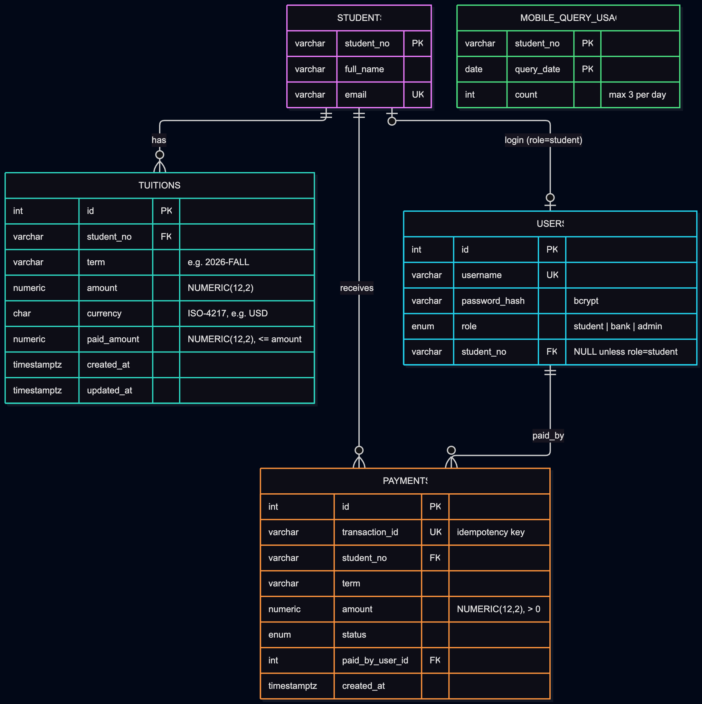
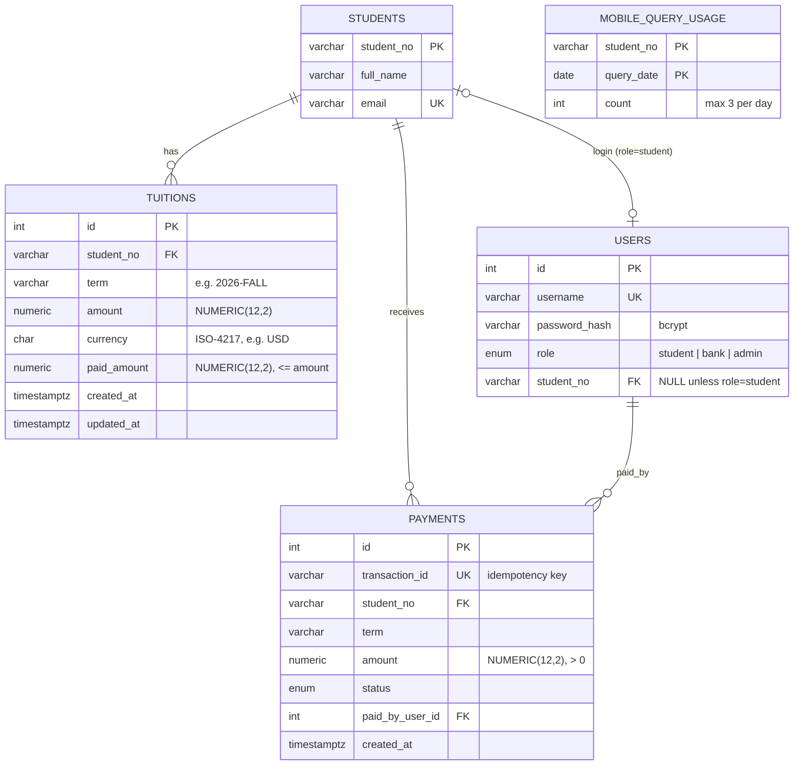

# ER Diagram

## Rules enforced by the database

| Rule                                        | Constraint                                                                       |
| ------------------------------------------- | -------------------------------------------------------------------------------- |
| One tuition per student and term            | `UNIQUE (student_no, term)`                                                      |
| No overpayment                              | `CHECK (paid_amount <= amount)`                                                  |
| No negative amounts                         | `CHECK (amount >= 0)`, `CHECK (paid_amount >= 0)`, `CHECK (payments.amount > 0)` |
| Duplicate transaction IDs rejected          | `UNIQUE (transaction_id)`                                                        |
| Only student users link to a student number | `CHECK` on `users`                                                               |
| Currency is a 3-letter ISO code             | `CHECK (currency ~ '^[A-Z]{3}$')`                                                |

Balance is not stored; it is always calculated as `amount - paid_amount`.
